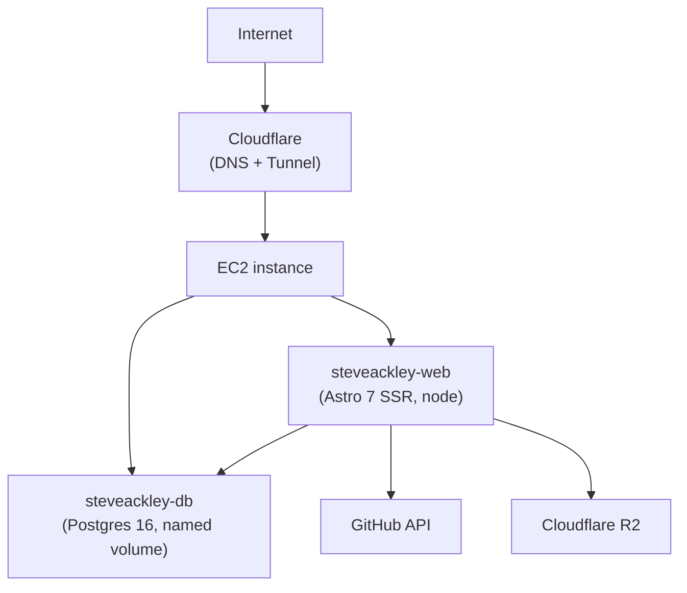

# Deployment Architecture

## Diagram



Single Docker Compose stack on one EC2 instance, fronted by a Cloudflare Tunnel (no inbound web ports — port 22 only).

## Domain

| Domain | Target |
|---|---|
| `steveackley.org` | The single deployed app (`steveackley-web` container) |

## Image Pipeline

```
git push main ──▶ CI (gh-actions ci-astro@v1) ──▶ build & push GHCR ──▶ SSH deploy
                  unit + integration + e2e         tags: latest + sha-<SHA>
```

- CI lives at `.github/workflows/deploy.yml`. Unit/integration/E2E delegated to the reusable `stevenfackley/gh-actions/.github/workflows/ci-astro.yml@v1`.
- Build job pushes `ghcr.io/stevenfackley/steveackley-web:latest` plus an immutable `sha-<SHA>` tag.
- Deploy job SSHes to EC2, writes `.env` from GitHub secrets, runs `docker compose pull web && docker compose up -d --remove-orphans`, and polls `http://localhost:3000/` until 200.

## Dockerfile

- Multi-stage `node:26-alpine` build + runner.
- **Builder uses `npm ci`** (lockfile-strict) — critical for reproducibility. The earlier `npm install --no-package-lock` allowed npm to drift dep resolution between local builds and CI, which silently flipped the JSX transform from automatic to classic and broke React island hydration in prod. Never re-introduce `--no-package-lock` in the Docker build.
- Runner copies only `dist/`, `node_modules/`, `package.json`, Drizzle config/migrations, and the entrypoint/seed scripts.

## Env Vars

| Variable | Used by | Source |
|---|---|---|
| `DATABASE_URL` | SSR pages, Drizzle migrations, Better Auth | GitHub Secret → `.env` |
| `BETTER_AUTH_SECRET`, `AUTH_SECRET` | Better Auth | GitHub Secret |
| `BETTER_AUTH_URL` | Auth redirect base | Hardcoded to `https://steveackley.org` in deploy.yml |
| `ADMIN_EMAIL`, `ADMIN_PASSWORD_HASH` | Seed admin on startup | GitHub Secret |
| `GH_API_TOKEN` | GitHub repo enrichment in `lib/github.ts` | GitHub Secret |
| `R2_*` (5 vars) | Media upload helper | GitHub Secret |
| `CLOUDFLARE_TUNNEL_TOKEN` | Cloudflare Tunnel sidecar container | GitHub Secret |
| `CRON_SECRET` | Scheduled-publish route (`/api/cron/publish-scheduled`) | GitHub Secret (optional) |

## Scheduled Publishing

A post saved unpublished with a schedule time is published by `/api/cron/publish-scheduled`, which `.github/workflows/publish-scheduled.yml` calls every 15 minutes. Both ends need the repository secret `CRON_SECRET`: the workflow sends it as a bearer token, and the deploy writes it to the server's `.env`. While the secret does not exist the workflow does nothing and the route answers 401 to everyone, so a scheduled post is not published by anything.

To turn it on:

1. Look at what the first run will publish. Every unpublished post whose time has passed goes public at once: `SELECT id, title, "scheduledAt" FROM "Post" WHERE published = false AND "scheduledAt" <= now();`. Clear the schedule time (or delete the post) for anything that should stay down.
2. Add the repository secret `CRON_SECRET` (a long random value).
3. Run the deploy workflow on `main`, so the server gets the secret. Until then the scheduled workflow fails with "The site refused the secret".

Server-side secrets that exist only at run time must be read with `process.env`. `import.meta.env.X` is replaced with a literal when the site is built, and the image build has no secrets, so such a read is `undefined` in production. `apps/site/scripts/check-built-routes.mjs` runs after the CI build and fails it if the scheduled-publish route's code was compiled away for that reason.

`GH_API_TOKEN` is still read through `import.meta.env` in `lib/github.ts`, so production makes its GitHub calls without the token. That is left as it is on purpose: with a token the code switches from the public repo list to `/user/repos`, which includes private repositories, so reading the token at run time would change what the public homepage lists. Decide that before changing the read.

## Data Persistence

- The compose file still defines a `steveackley-db` Postgres container with the named volume `postgres_data`.
- The deploy writes `DB_PUSH_ON_BOOT=0` to `.env` because the schema is managed by qavren-db provisioning (see `.github/workflows/deploy.yml` and `docker/entrypoint.sh`). Which database prod actually talks to is set by the `DATABASE_URL` secret.
- Uploads bind-mount `./uploads:/app/uploads` (legacy; R2 is the long-term store).

## Cloudflare Tunnel

A `cloudflared` sidecar container holds an outbound tunnel from EC2 to Cloudflare's edge. All HTTPS traffic enters via the tunnel; there is no inbound `:80` or `:443` open on the EC2 security group. See [deployment/CLOUDFLARE_TUNNEL_SETUP.md](./deployment/CLOUDFLARE_TUNNEL_SETUP.md) for setup detail.

## Why Single Container

A personal site + blog + admin doesn't justify a Kubernetes cluster. One EC2 instance with Docker Compose covers prod, with named-volume data persistence and immutable image tags providing roughly the same operational story for far less ongoing complexity.
