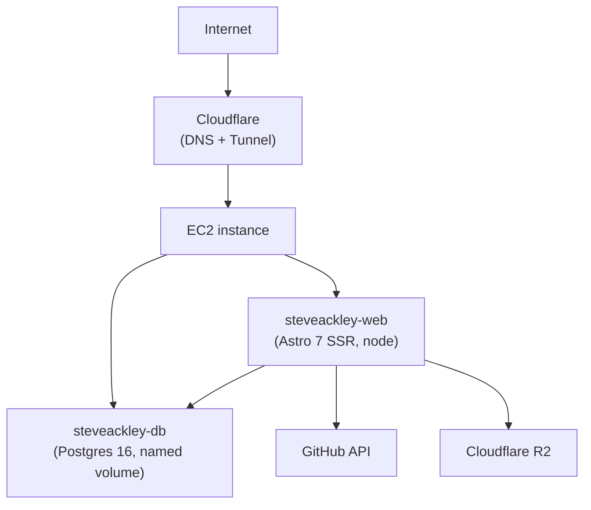

# Deployment Architecture

## Diagram



Single Docker Compose stack on one EC2 instance, fronted by a Cloudflare Tunnel (no inbound web ports — port 22 only).

## Domain

| Domain | Target |
|---|---|
| `steveackley.org` | The single deployed app (`steveackley-web` container) |

## Image Pipeline

```
git push main ──▶ CI (gh-actions ci-astro@v1) ──▶ build & push GHCR ──▶ SSH deploy
                  unit + integration + e2e         tags: latest + sha-<SHA>
```

- CI lives at `.github/workflows/deploy.yml`. Unit/integration/E2E delegated to the reusable `stevenfackley/gh-actions/.github/workflows/ci-astro.yml@v1`.
- Build job pushes `ghcr.io/stevenfackley/steveackley-web:latest` plus an immutable `sha-<SHA>` tag.
- Deploy job SSHes to EC2, writes `.env` from GitHub secrets, runs `docker compose pull web && docker compose up -d --remove-orphans`, and polls `http://localhost:3000/` until 200.

## Dockerfile

- Multi-stage `node:26-alpine` build + runner.
- **Builder uses `npm ci`** (lockfile-strict) — critical for reproducibility. The earlier `npm install --no-package-lock` allowed npm to drift dep resolution between local builds and CI, which silently flipped the JSX transform from automatic to classic and broke React island hydration in prod. Never re-introduce `--no-package-lock` in the Docker build.
- Runner copies only `dist/`, `node_modules/`, `package.json`, Drizzle config/migrations, and the entrypoint/seed scripts.

## Env Vars

| Variable | Used by | Source |
|---|---|---|
| `DATABASE_URL` | SSR pages, Drizzle migrations, Better Auth | GitHub Secret → `.env` |
| `BETTER_AUTH_SECRET`, `AUTH_SECRET` | Better Auth | GitHub Secret |
| `BETTER_AUTH_URL` | Auth redirect base | Hardcoded to `https://steveackley.org` in deploy.yml |
| `ADMIN_EMAIL`, `ADMIN_PASSWORD_HASH` | Seed admin on startup | GitHub Secret |
| `GH_API_TOKEN` | GitHub repo enrichment in `lib/github.ts` | GitHub Secret |
| `R2_*` (5 vars) | Media upload helper | GitHub Secret |
| `CLOUDFLARE_TUNNEL_TOKEN` | Cloudflare Tunnel sidecar container | GitHub Secret |
| `CRON_SECRET` | Scheduled-publish route (`/api/cron/publish-scheduled`) | GitHub Secret (optional) |

## Scheduled Publishing

A post saved unpublished with a schedule time is published by `/api/cron/publish-scheduled`, which `.github/workflows/publish-scheduled.yml` calls every 15 minutes. Both ends need the repository secret `CRON_SECRET`: the workflow sends it as a bearer token, and the deploy writes it to the server's `.env`. While the secret does not exist the workflow does nothing and the route answers 401 to everyone, so a scheduled post is not published by anything.

While it is off, the post form says so under the schedule field instead of promising a publish time.

To turn it on:

1. Look at every post that is waiting on a schedule time. The first run publishes all of them whose time has passed, however old: `SELECT id, title, "scheduledAt" FROM "Post" WHERE published = false AND "scheduledAt" IS NOT NULL ORDER BY "scheduledAt";`. Clear the schedule time (or delete the post) for anything that should stay down. `"scheduledAt"` holds UTC with no zone, so read the times as UTC and do not rely on a comparison with `now()` in a SQL client.
2. Add `CRON_SECRET` as a **repository** secret. Not in the `production` environment: the scheduled workflow's job has no environment, would not see it, and would stay off without any error. Make the value with `openssl rand -hex 32`: letters and digits only, so neither the deploy script's shell nor Compose can change it on the way to the server.
3. Run the deploy workflow on `main`, so the server gets the secret. Until then the scheduled workflow fails with "The site refused the secret".

To turn it off again, delete the secret and run a deploy. Deleting the secret alone stops the caller, but the server keeps accepting the old value until the next deploy rewrites `.env`.

Things to know once it is on. Publishing happens at the next run, and GitHub's schedule is best effort, so a post can go out late. A run that finds the site down fails and sends mail; nothing is lost, the next run catches up. The run's log, which is public, shows the id, title and slug of each post as it is published. The server logs the same under "Published scheduled posts". GitHub turns scheduled workflows off in a public repository after 60 days with no activity; if scheduled posts stop going out, look at the workflow's page first.

Server-side secrets that exist only at run time must be read with `process.env`. `import.meta.env.X` is replaced with a literal when the site is built, and the image build has no secrets, so such a read is `undefined` in production. The secret is read in one place, `apps/site/src/lib/scheduler.ts`. `apps/site/scripts/check-built-routes.mjs` runs after the CI build and fails it if that read, the GitHub token read or the scheduled-publish route's code was compiled away for that reason.

## GitHub Token And The Homepage's Repo List

The homepage lists repositories from GitHub (`lib/github.ts`). `GH_API_TOKEN` is read at run time, like `CRON_SECRET`, and the same build check covers the read.

- **No token:** the public list, at the anonymous rate limit. This is production today (no `GH_API_TOKEN` secret exists).
- **A fine-grained personal access token** (it starts with `github_pat_`): the public list, plus every private repository that token was given access to, shown on the public homepage with a "Private" badge. The same list is served as JSON at `/api/github/repos`. For each listed private repository that makes public: its name, description, language, topics, the badge lines of its README and when it was last pushed. Its link leads to a GitHub 404 for visitors.
- **Any other token** (a classic `ghp_` token, an OAuth token): the public list only. The token still authenticates the calls, which raises the rate limit, and the server logs once that private repositories are not listed. A classic token with the `repo` scope can read every private repository the account owns, so it is never allowed to decide what the public homepage shows.

So the list of private repositories on the homepage is exactly the list chosen when the fine-grained token was created ("Only select repositories"). To add or remove one, edit the token's repository access; no deploy is needed (the list is cached for 30 seconds).

Forks, archived repositories, templates and infrastructure repositories are dropped by the filters in `lib/github.ts` in every case. The fixed skip list there matches by name, so a repository renamed after the list was written is no longer matched; with a fine-grained token that no longer matters, because the token's access is the control.

To turn it on: create the fine-grained token (repository access: only the repositories to show; permissions: Contents read and Metadata read), add it as the repository secret `GH_API_TOKEN`, then run the deploy workflow on `main`. The CI end-to-end job also receives the secret and renders the homepage with it.

## Data Persistence

- The compose file still defines a `steveackley-db` Postgres container with the named volume `postgres_data`.
- The deploy writes `DB_PUSH_ON_BOOT=0` to `.env` because the schema is managed by qavren-db provisioning (see `.github/workflows/deploy.yml` and `docker/entrypoint.sh`). Which database prod actually talks to is set by the `DATABASE_URL` secret.
- Uploads bind-mount `./uploads:/app/uploads` (legacy; R2 is the long-term store).

## Cloudflare Tunnel

A `cloudflared` sidecar container holds an outbound tunnel from EC2 to Cloudflare's edge. All HTTPS traffic enters via the tunnel; there is no inbound `:80` or `:443` open on the EC2 security group. See [deployment/CLOUDFLARE_TUNNEL_SETUP.md](./deployment/CLOUDFLARE_TUNNEL_SETUP.md) for setup detail.

## Why Single Container

A personal site + blog + admin doesn't justify a Kubernetes cluster. One EC2 instance with Docker Compose covers prod, with named-volume data persistence and immutable image tags providing roughly the same operational story for far less ongoing complexity.
